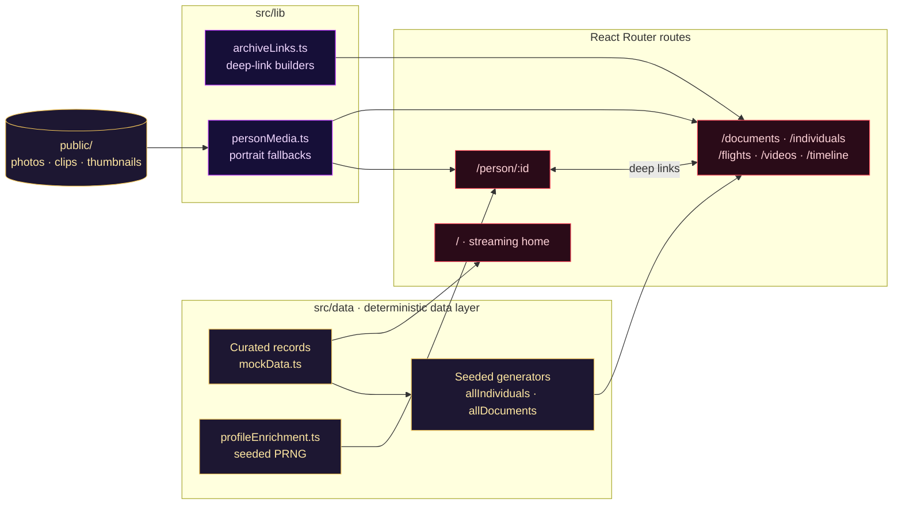

<p align="center">
  
</p>

<p align="center">
  
</p>

<p align="center">
  <a href="https://github.com/kamikaze1120/investigate-hub/commits/main"></a>
  
  
  
</p>

**DREADFLIX** (repo: `investigate-hub`) is a cinematic, streaming-inspired interface for exploring a large investigative record archive. It treats people as the connective tissue: from any profile you can jump to the documents, flights, timeline events, videos and other people linked to it, and every list is searchable, filterable and deep-linkable. It is a **frontend portfolio build** — the archive is a small curated set plus deterministic, seeded generated records, not a live data pipeline.

<p align="center"><sub><code>REACT 18</code> ✦ <code>TYPESCRIPT</code> ✦ <code>FRAMER MOTION</code> ✦ <code>DEEP LINKS</code> ✦ <code>SEEDED DATA</code> ✦ <code>NO BACKEND</code></sub></p>

<h2 align="center">✦ THE EXPERIENCE ✦</h2>
<p align="center"><sub>SEVEN ROUTES · ONE CONNECTED ARCHIVE</sub></p>

<table>
  <tr>
    <td width="33%" valign="top">🎬 <b>Streaming home</b><br><sub>Animated hero stats, category tiles, quick actions and horizontal shelves of people, documents, flights and video.</sub></td>
    <td width="33%" valign="top">🧑‍💼 <b>Person profiles</b><br><sub><code>/person/:id</code> collects linked documents, flights, timeline events, videos and connections for one individual.</sub></td>
    <td width="33%" valign="top">📄 <b>Document archive</b><br><sub>Type filters + text search over the full index, 60 per page, reading filters from both the URL and router state.</sub></td>
  </tr>
  <tr>
    <td valign="top">✈️ <b>Flight explorer</b><br><sub>Search by route, location or passenger; every passenger chip links to their profile.</sub></td>
    <td valign="top">🎞️ <b>Video library</b><br><sub>Thumbnails, a playback modal and links to the people referenced in each entry.</sub></td>
    <td valign="top">🕰️ <b>Timeline</b><br><sub>Chronological events, each tagged with the people it involves.</sub></td>
  </tr>
  <tr>
    <td valign="top">🔎 <b>Global search</b><br><sub>Navbar search across documents, people and flights, plus quick-pick shortcuts.</sub></td>
    <td valign="top">⚖️ <b>Disclaimer gate</b><br><sub>A first-visit legal notice (remembered in <code>localStorage</code>): a name appearing does not imply wrongdoing.</sub></td>
    <td valign="top">🖼️ <b>Media fallbacks</b><br><sub>Deterministic generated portraits and thumbnails keep every card visually complete when no local asset exists.</sub></td>
  </tr>
</table>

<h2 align="center">◈ HOW IT'S BUILT ◈</h2>
<p align="center"><sub>A CLIENT-ONLY APP WITH A SEEDED DATA LAYER</sub></p>



<details>
<summary><b>What the numbers on screen actually are</b></summary>

| Shown as | Where it comes from |
|---|---|
| Documents indexed — 248,192 | `TOTAL_DOCUMENTS_INDEXED` in `src/data/allDocuments.ts`. A few curated entries, then records are **generated on demand per page** by index, so the full set is never held in memory. |
| Individuals referenced — 21,847 | `allIndividuals.ts`: curated top profiles plus names built from first/last-name pools with `seededRandom(42)`. |
| Flight records — 1,826 | `TOTAL_FLIGHT_LOGS` in `mockData.ts`: curated logs plus generated routes between a fixed airport list. |
| Video entries | `TOTAL_RELEASED_VIDEOS` = the number of bundled clips (37 in `public/videos`). |

Every generated value is seeded, so lists, profiles and links are identical on every reload — useful for QA and design iteration, and the reason the counts should be read as UI scale tests, not facts about any real archive.

</details>

<h2 align="center">◆ TECH STACK ◆</h2>
<p align="center"><sub>FROM <code>package.json</code></sub></p>

<p align="center">
  
</p>

| Layer | What's used |
|---|---|
| Framework | React 18 + Vite 5 (SWC plugin), TypeScript 5 |
| Routing / data | React Router 6, TanStack Query 5 |
| UI | Tailwind CSS 3, shadcn/ui on Radix primitives, Lucide icons |
| Motion | Framer Motion 12 |
| Tests | Vitest + Testing Library setup (one placeholder test), Playwright config |

<h2 align="center">✦ RUN IT LOCALLY ✦</h2>
<p align="center"><sub>NO KEYS · NO ENV FILE · NO BACKEND</sub></p>

```bash
git clone https://github.com/kamikaze1120/investigate-hub.git
cd investigate-hub
npm install
npm run dev
```

Open the URL Vite prints. The repo is ~145 MB because the video clips live in `public/videos` — a partial clone (`git clone --filter=blob:none …`) keeps the first download lighter.

| Script | What it does |
|---|---|
| `npm run dev` | Vite dev server |
| `npm run build` | Production build to `dist/` |
| `npm run build:dev` | Development-mode build |
| `npm run preview` | Serve the built app |
| `npm run lint` | ESLint |
| `npm test` | Vitest, single run (`npm run test:watch` for watch mode) |

<h2 align="center">◈ PROJECT MAP ◈</h2>
<p align="center"><sub>WHERE THINGS LIVE</sub></p>

<details>
<summary><b>Folder tree</b></summary>

```text
investigate-hub/
├─ src/
│  ├─ App.tsx              routes: /, /person/:id, /individuals, /documents,
│  │                       /videos, /timeline, /flights, 404
│  ├─ pages/               route-level views (Index, PersonProfile, All*)
│  ├─ components/          Navbar, HeroStats, HubTiles, ContentRow, cards,
│  │                       VideoModal, DisclaimerModal, ui/ (shadcn)
│  ├─ data/                types, curated records, seeded generators, enrichment
│  ├─ lib/                 archiveLinks (deep links), personMedia (portraits)
│  └─ test/                Vitest setup + example test
├─ public/
│  ├─ photos/              local portrait images
│  └─ videos/              clips/ and thumbnails/
└─ memory.md               change log of the last data-quality pass
```

</details>

<h2 align="center">◆ SCOPE &amp; HONESTY ◆</h2>
<p align="center"><sub>READ THIS BEFORE QUOTING ANYTHING FROM THE APP</sub></p>

- This is a UI/UX and frontend-architecture demo. Most records, titles, summaries and relationships are **generated placeholders** so the interface can be exercised at scale; video entries reuse a small local clip library.
- Nothing in the app is a source of record. Do not cite it as evidence about any person — the in-app disclaimer applies: appearing in the archive does not imply wrongdoing.
- Known constraints are tracked in [`memory.md`](memory.md).

<p align="center">
  
  <br>
  <sub><code>◉ DREADFLIX // GILDED ORBIT</code> · built by <a href="https://github.com/kamikaze1120">kamikaze1120</a></sub>
</p>
